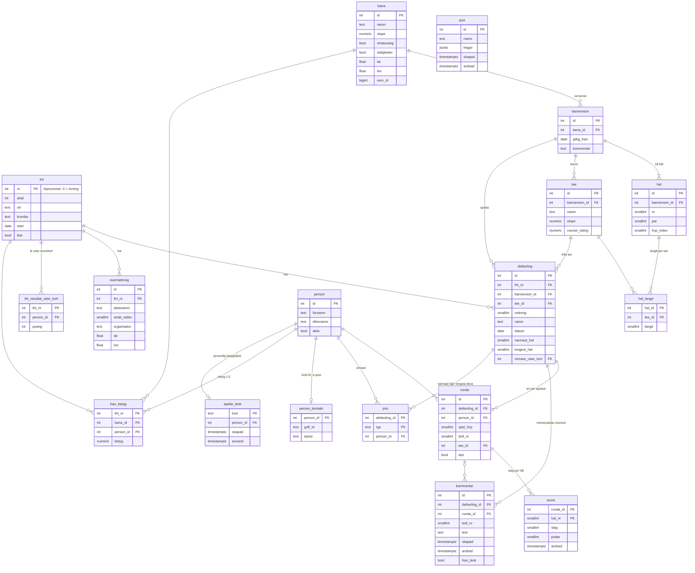

# THT – datamodell

Databasen ligger i Supabase (Postgres). Schemat byggs upp av filerna i `supabase/` i nummerordning. All statistik **beräknas i vyer** från slagen – inget lagras dubbelt.
*Uppdaterad 2026-10-18 (v0.33.0): quiz, minnesvärda moment, övningsrunda (THT 0), inbördes möten.*

## Vyer (beräknad statistik)

| Vy | Innehåll |
| --- | --- |
| `v_score_alla`, `v_runda_alla` | Som `v_score`/`v_runda` men med övningen (THT 0) – bara för ställningen vid inmatning |
| `v_score` | Varje hål: par, index, extraslag, slag, slag med tak (par + 5), poäng (Stableford), resultat (birdie, par …) |
| `v_runda` | Varje runda: antal hål, slag, poäng, puttar, placering i deltävlingen (lika poäng → lägst spel-HCP) |
| `v_tht_resultat` | Varje spelare och THT: rundor, poäng, slag, puttar, placering. Tar med `tht_resultat_utan_kort` för år utan scorekort |
| `v_tht_kurva` | THT-grafen: ackumulerade poäng hål för hål |
| `v_stat_fordelning` | Eagle … quint+ per spelare och THT |
| `v_stat_par` | Poäng och slag per hålpar (3/4/5) |
| `v_stat_halvinst` | Hålvinster på slag, alla och ensamma |
| `v_stat_runda` | Birdies och längsta svit par eller bättre per runda |
| `v_stat_hal` | Snitt över par och poäng per bana och hål |
| `v_stat_totalt` | Rundor, banor, hål, poäng, slag, puttar och meter per spelare |
| `v_inbordes` | Inbördes möten: en rad per spelare, motståndare och deltävling där båda har en hel runda; utfall på poäng och slag (1/0/−1) |
| `v_inbordes_summa` | Vinster–oavgjort–förluster per spelare och motståndare (poäng och slag), poängdiff, senaste år |

## Regler i databasen

- **Minnesvärda moment** (`kommentar`, migrering 21): gäller hela deltävlingen, en boll (`boll_nr`) eller en runda (`runda_id`; deltävlingen sätts då från rundan). Admin och markör får skriva, ändra och ta bort även i avslutade THT. Ersätter `runda.kommentar` (borttagen 2026-10-18).

- **Läsa:** alla (utom `person_kontakt` och länkkoderna, som bara admin/markör ser).
- **Skriva:** admin allt; markör bara rundor, slag, bollar och priser i THT som inte är avslutade, samt banbetyg (alla år). Se `supabase/10_behorighet.sql`, `11_…`, `13_…`.
- **Övningsrunda:** THT 0 "Övning" med en deltävling. Alltid öppen för markören, filtreras bort i `v_score`/`v_runda` och därmed i all statistik. Inga priser eller banbetyg (trigger `inte_ovning`). Admin tömmer den med knappen i Mata in (migrering 22).
- **Minnesvärt moment via länk:** `minne_lank_info(kod)` och `lamna_minne(kod, deltävling, text)` – ett eget moment per deltävling och spelare, bara om den egna rundan (`fran_lank = true`, migrering 23).
- **Quiz** (migrering 24): fristående tabell, bara admin läser och skriver. `fragor` är en ögonblicksbild (jsonb): fråga, svar, fel (0–3), info, ämne, egen.
- **Banbetyg via länk:** funktionerna `betyg_lank_info(kod)` och `lamna_banbetyg(kod, betyg)` – anropas utan inloggning och kontrollerar koden.
